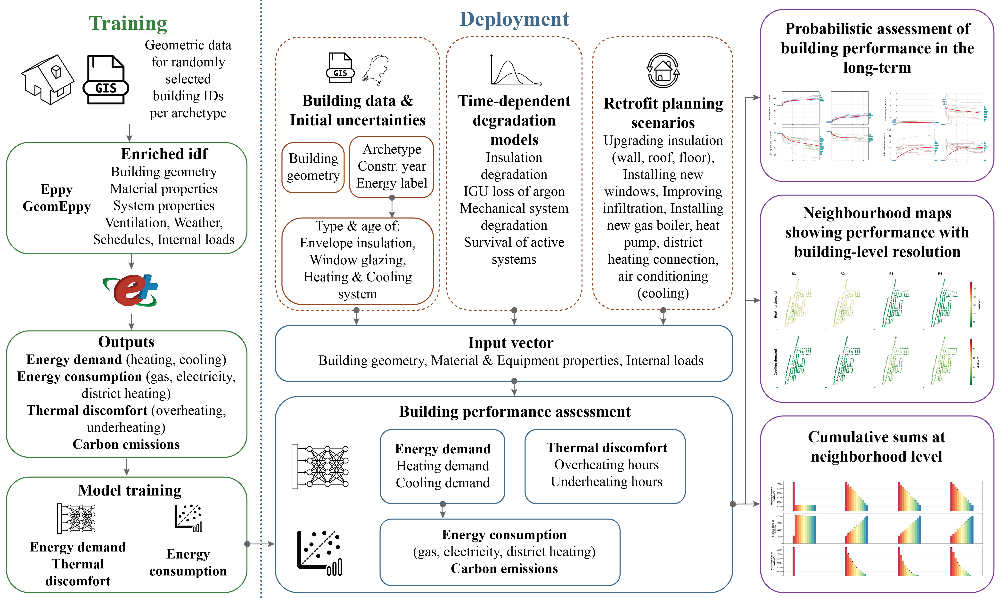
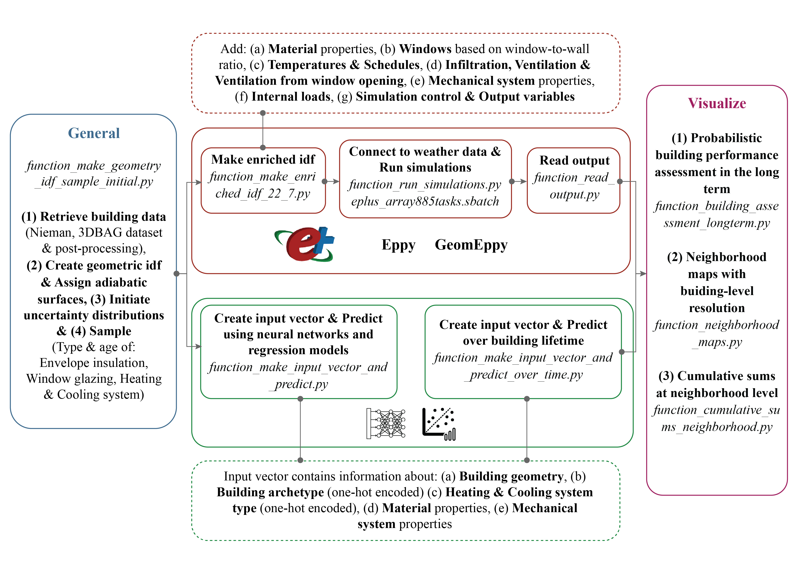
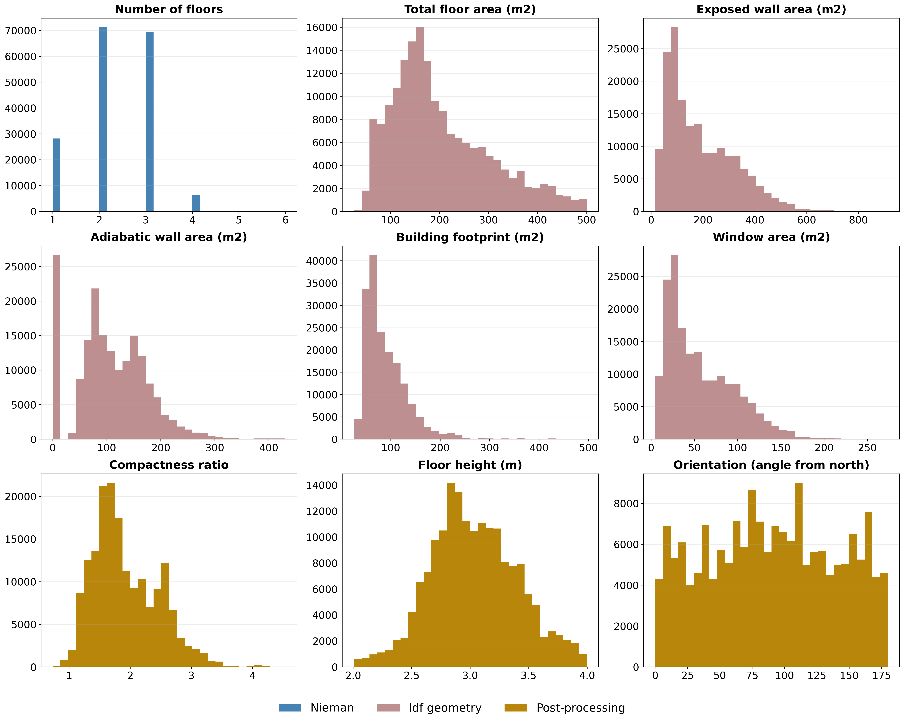
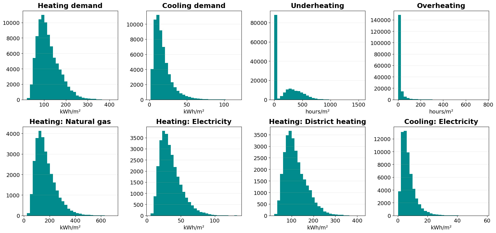

# A repository for uncertainty-aware building-level performance assessment at scale under diverse retrofit scenarios

This repository contains the implementation code for the methodological framework described in the paper "A systematic framework for urban-scale building energy and thermal discomfort assessment under uncertainty: Applications to urban retrofit planning". The code allows for assessment of diverse building performance indicators (i.e. energy, thermal discomfort, environmental impact); (i) probabilistically along the building lifetime, (ii) at neighborhood scale, while maintaining building-level resolution, and (iii) as cumulative sum for the whole neighborhood, with the respective confidence intervals. The outcomes can provide targeted building-level insights that can support policymakers in developing retrofit planning strategies and achieving building-level translation of neighborhood-scale policies.

The performance assessment can be conducted either by connecting to EnergyPlus simulation engine or through using the surrogate models (neural networks & regression models) that are trained to predict the performance indicators. In both cases, epistemic uncertainties, arising from data unavailability, and aleatoric uncertainties, associated with material degradation and mechanical system failures, are considered in the assessment. The synthetic database used for training the surrogate models is also provided in the repository along with the respective Jupyter notebooks used for training.



For more information, please refer to the [paper]().

## Installation 

### 1. Install EnergyPlus v.23-2-0 

In case you want to perform the energy assessment using Energyplus, you must have downloaded and installed the application from [https://github.com/NREL/EnergyPlus/releases/tag/v23.2.0](https://github.com/NREL/EnergyPlus/releases/tag/v23.2.0).

### 2. Create the virtual environment

```
conda create --name retr_pred_scale -y python==3.10
conda activate energy_prediction_scale_env
```

### 3. Install the dependencies

```
pip install ipykernel
pip install geomeppy==0.11.8
pip install geopandas==1.0.1
pip install torch==2.13.0
pip install scikit-learn
pip install wandb
```

You can find the full list of dependencies in *requirements.txt*.

## Code overview

The first part of the assessment serves to retrieve the building data from the open-source GIS databases and create the initial idf file that contains only the building geometry. Subsequently, some surfaces are assigned as adiabatic. The number of adiabatic surfaces per floor is determined based on the archetype of the building, and the surfaces with the largest areas are assigned first. The probabilistic distributions for type and age of (i) envelope insulation (wall, roof, floor), (ii) window glazing, (iii) heating and cooling are initialized based on the archetype, construction year and energy label and samples are drawn to create the sets of variables for the simulations.

The assessment for all sets of variables can be conducted following two paths; (a) EnergyPlus path and (b) Surrogate model path. Regarding the EnergyPlus path, enriched idf files are created for each of the sampled set of variables. Different idf files are created for heating and cooling since the assessment happens for different periods (Heating season: October to March, Cooling season: April to September). After running the simulations, the output values are stored in a Pandas DataFrame with one row corresponding to one sample.
Regarding the surrogate path, the performance assessment can be conducted for the year that the samples were drawn or probabilistically for the building lifetime, accounting for time-dependent degradation and failure of mechanical systems. Moreover, the long-term probabilistic assessment can be combined with retrofit actions in specific years and can be upscaled for a whole neighborhood or district.

The outputs can be visualized either for (i) a single building, showing the mean trends and characteristic realizations over building lifetime, or (ii) for the neighborhood, producing maps per output variable that maintain building-level resolution and histograms showing cumulative sums and confidence intervals per year.



The EnergyPlus path was used to produce the synthetic database that was used for the training of the surrogate models. The design of the database and all related information are provided on the paper. Both the synthetic database and the notebooks used for training are provided in this repository.





Below you can find the directory structure along with a short explanation of the files:

```
Retrofit_prediction_scale
├── Bash files: Files to run multiple simulations in DelftBlue using both the EnergyPlus and the surrogate path
├── INP_epw_file: Folder containing the weather data in epw form
├── INP_idf_functions:
	├── create_idf_file.py: Create idf containing building geometry
	├── dbn_functions2.py: Functions to initialize probabilistic distributions and sample 
	├── get_retrofit_data2.py: Get initial values per archetype, update construction materials in the idf
	├── getdata_functions_apartment.py: Modify the geometric data in the case that the unit under evaluation is an apartment
	├── getdata_functions_building.py: Retrieve building information from open GIS databases and post-process
	├── modify_idf_for_simulation2.py: Functions to create all necessary idf objects for the enriched idf.
	├── woon_functions_distr2.py: Supporting functions to compute the initial probabilistic distributions conditioned on the building archetype, construction year and energy label
├── INP_transitions_initial_probs:
	├── 09_12_2025_degrad_prob_ins.npz: Transition matrices for insulation ageing per year, computed based on data grom the Gamma distributions
	├── 09_12_2025_init_ageing_factor_ins.npz: Probabilities of initial ageing of insulation based on the ageing year
	├── 12_05_2026_probs_deg_HVAC70.npz: Survival probabilities per year for gas boiler, heat pump and air conditioning, computed based on data from Weibull distributions
	├── 20_7_2026_initial_probs.npz: Initial probabilities for all combinations of building archetype, construction year and energy label as computed from Woon database.
├── OUT_functions:
├── output_predict2.py: Main function to connect to the neural networks and regression models for prediction
├── OUT_models: Neural networks and regression models to compute the output variables (Models, Input & Output scalers & Meta data)
├── simulation_files: Main folder to save idfs upon creation & outputs from EnergyPlus simulations
├── training: Synthetic database and Jupyter notebooks used for training
├── ep_function_make_enriched_idf.py: Function to create the enriched idf with material & system properties
├── ep_function_read_output.py: Function to read the output from the EnergyPlus simulations
├── ep_function_run_simulations.py: Function to run the EnergyPlus simulations
├── ep_nieman_tudelft_18_10.csv: Input data from Nieman report for all buildings in Rotterdam
├── gen_building_class.py: Building class and associated functions
├── gen_function_make_geometry_idf_sample_initial.py: Function to create the initial geometric idf, define initial probabilistic distributions per building & sample
├── initial_file_running_functions.ipynb: Main file to run & conduct all assessments
├── kralingseveer_buildings_27_2.shp: QGIS files for Kralingseveer neighborhood (to be used for the creation of the maps)
├── …
├── pands_kralingseveer.csv: BAG Pand IDs & Building footprint coordinates for all buildings in Kralingseveer neighborhoos
├── running_means_limit.csv: .csv file with limits for maximum acceptable interior temperature
├── surr_function_make_input_vector_and_predict_over_time.py: Function to perform the assessment of all performance indicators over the building lifetime
├── surr_function_make_input_vector_and_predict.py: Function to perform the assessment of all performance indicators for single year
├── template_idf.idf: Empty idf file to be used as base for the idf generation
├── vis_function_building_assessment_longterm.py: Function to visualize the probabilistic assessment of all performance indicators over the building lifetime
├── vis_function_cumulative_sums.py: Function to visualize the cumulative sum for the whole neighborhood per year with confidence intervals
├── vis_function_neighborhood_maps.py: Function to produce neighborhood maps showing the assessment of all performance indicators with building-level resolution
```

## How to run the building performance assessment

The notebook *initial_file_running_functions.ipynb* serves to guide you through the performance assessment process.

## Acknowledgements 

This material is based upon work supported by the [DE-CIST project](https://de-cist.com/) under the ICLEI Action Fund, the [MultiCare EU project](https://multicare-project.eu/) (GA no. 101123467), and the TU Delft AI Labs program.
The repository is inspired by [jax-imprl](https://github.com/omniscientoctopus/jax-imprl) and [AmsterTime](https://github.com/seyrankhademi/AmsterTime).

The building energy performance simulations are conducted using [EnergyPlus](https://energyplus.net/) and the respective input data files (.idf) are generated using [Eppy](https://github.com/santoshphilip/eppy) and [GeomEppy](https://github.com/jamiebull1/geomeppy) Python libraries. The code is using data from Nieman report [1] (provided by Gemeente Rotterdam) and open-source data from 3DBAG [2]. The probabilities of having specific material properties and equipment type are calculated based on data from the Woon database [3]. Lastly, the TMY data are extracted from climateonebuilding.org [4].


[1] Nieman De Raadgevende Ingenieurs, "Rapport standaard en streefwaardes bestaande woningbouw," 2021.

[2] R. Peters, B. Dukai, S. Vitalis, J. Van Liempt and J. Stoter, "Automated 3D Reconstruction of LoD2 and LoD1 Models for All 10 Million Buildings of the Netherlands," Photogrammetric Engineering & Remote Sensing, vol. 88, no. 3, pp. 165-170, 2022. 

[3] C.B.v.d.S. (Ministerie van Volkshuisvesting en Ruimtelijke Ordening (VRO)), "Woononderzoek Nederland 2024 - woningmarktmodule- release 1.1," 2025.

[4] "Climate-OneBuilding.Org," [Online]. Available: https://climate.onebuilding.org/. [Accessed 13 03 2025].

## Citation
The source code in this repository is released under the MIT License. If you would like to refer to our work, please consider citing:

A. M. Koniari, C. P. Andriotis, S. Bianchi, P. G. Morato, S. Khademi and M. Overend, "Predicting building operational energy under material degradation and climate uncertainty: A sensitivity analysis," in *UNCECOMP 2025 6th ECCOMAS Thematic Conference on Uncertainty Quantification in Computational Sciences and Engineering*, 2025.

```
@inproceedings{koniari2025sens,
  author    = {Koniari, A. M. and Andriotis, C. P. and Bianchi, S. and Morato, P. G. and Khademi, S. and Overend, M.},
  title     = {Predicting building operational energy under material degradation and climate uncertainty: A sensitivity analysis},
  booktitle = {UNCECOMP 2025: 6th ECCOMAS Thematic Conference on Uncertainty Quantification in Computational Sciences and Engineering},
  year      = {2025}
}
```


